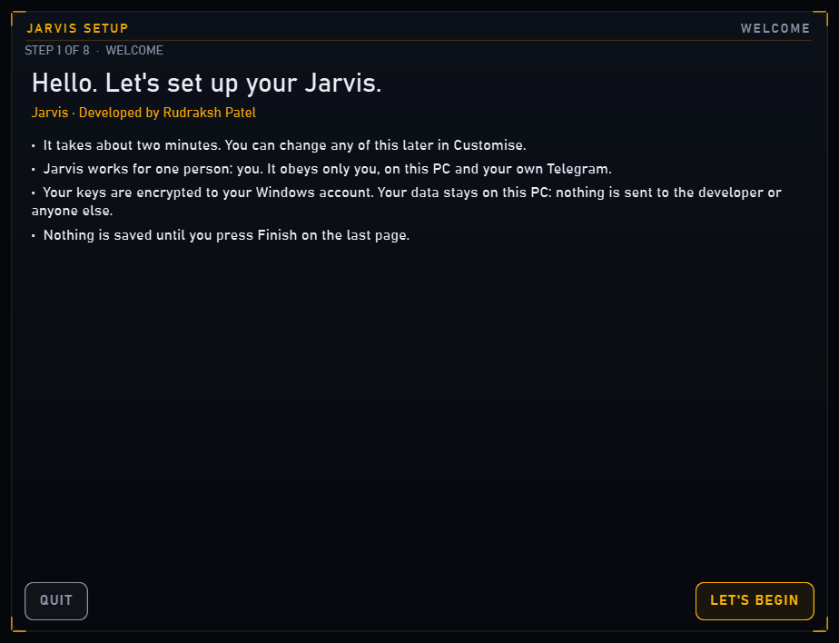
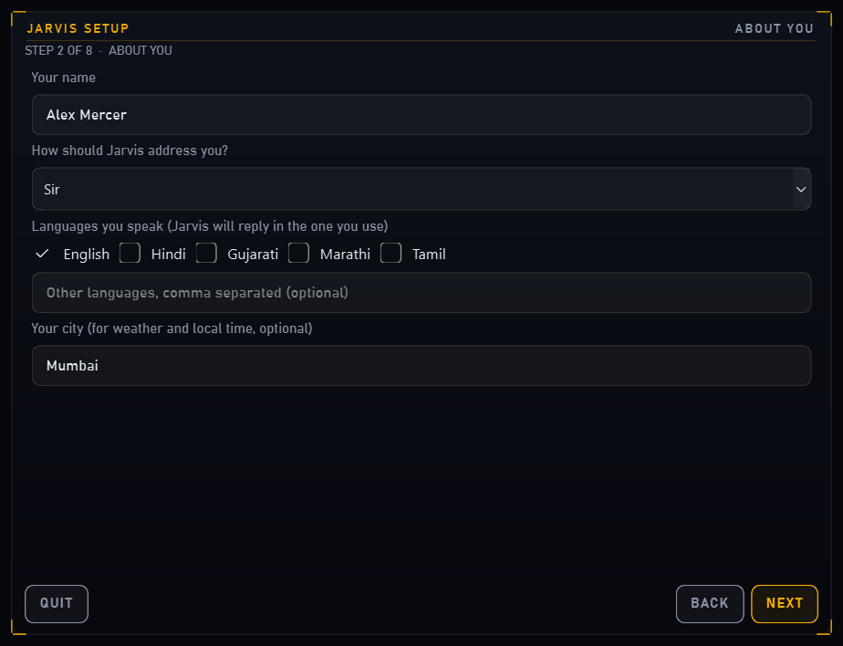
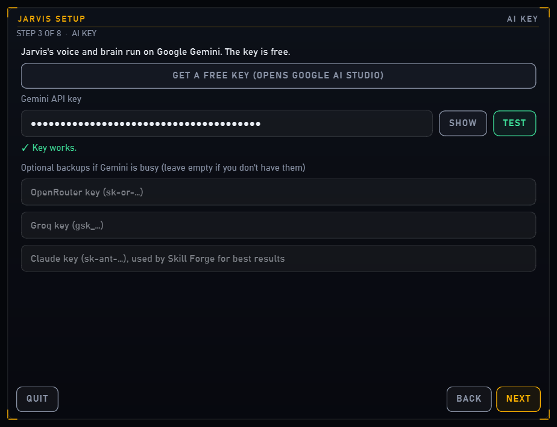
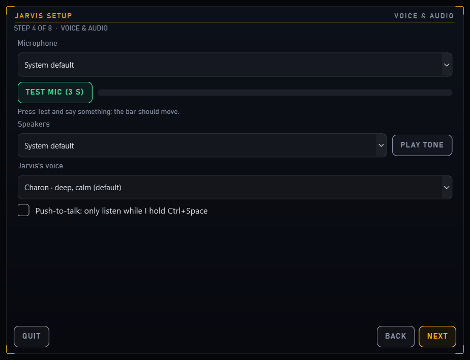
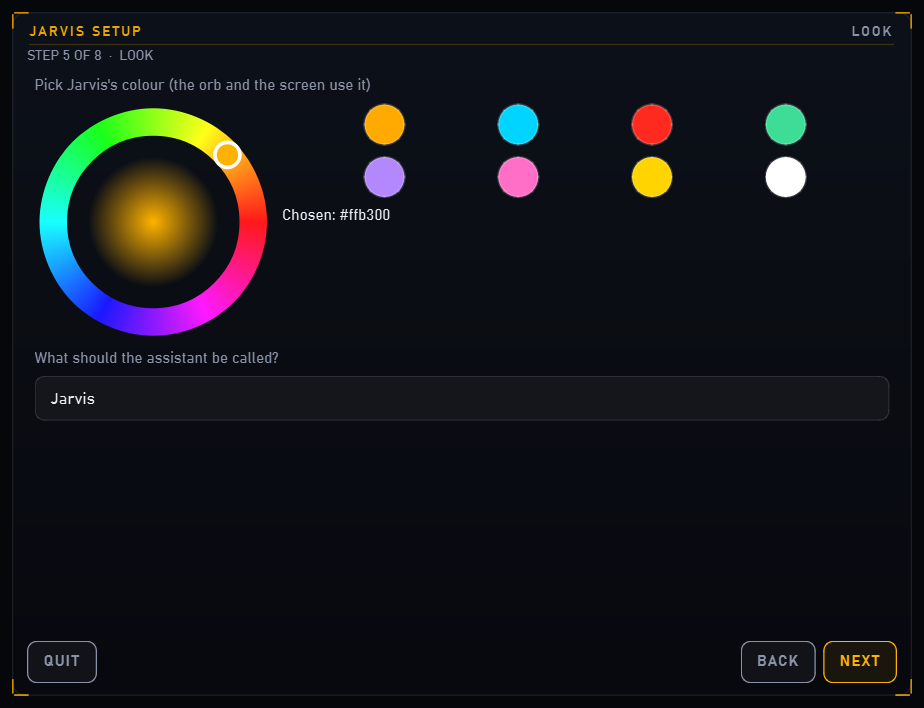
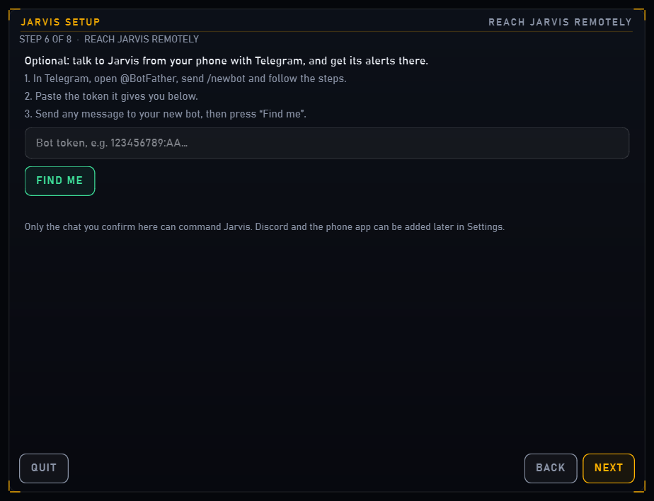
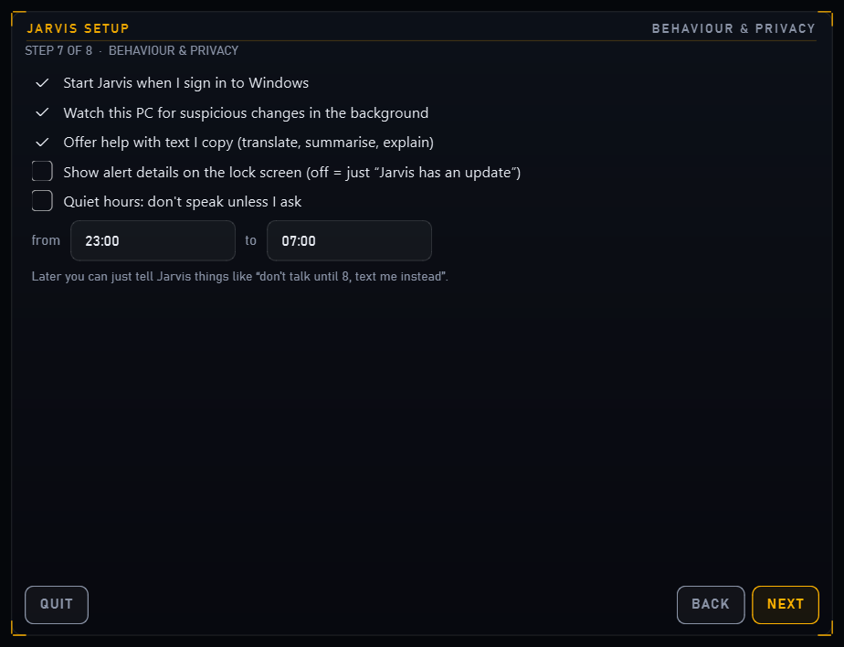
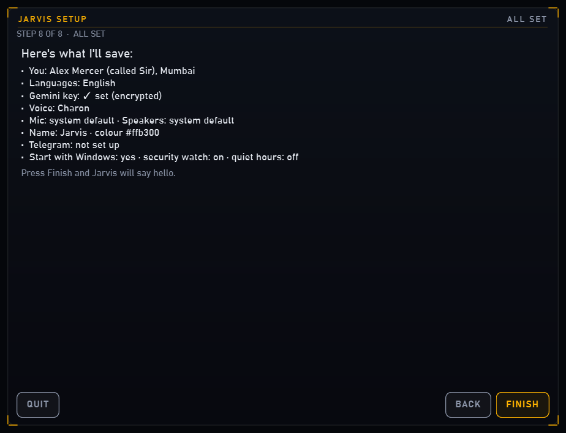

# Jarvis

**A personal AI assistant for Windows that you talk to like a friend.**
*Jarvis · Developed by Rudraksh Patel*

Jarvis listens and talks back in real time, lets you interrupt it mid-sentence, and runs your PC for you:
apps, files, documents, web research, website analysis, reminders, routines, smart-home devices and more.
It works for **one person, you**: it obeys only you, keeps your data on your own PC, and asks before anything risky.

---

## Install (2 minutes)

1. **Download** `Jarvis-1.0.0.msi` from the [**latest release**](../../releases/latest).
2. **Double-click** the file.
   - If Windows shows *"Windows protected your PC"*, click **More info → Run anyway**.
     (The installer isn't code-signed yet, so Windows doesn't recognise the publisher.)
3. **Accept the licence** and click **Install**. No administrator password is needed: Jarvis installs just for
   your Windows account, in `%LOCALAPPDATA%\Programs\Jarvis`.
4. Open **Jarvis** from the Start menu or the desktop shortcut.

That's it. There's no Python, no command line and no extra downloads.

**You need:** Windows 10 or 11 (64-bit), a microphone and speakers (or a headset), internet, and a free
Google Gemini key (the setup shows you where to get one, in one click).

---

## First-run setup

The first time Jarvis opens, it asks a few questions. Nothing is saved until you press **Finish**, and you can
change everything later in **Customise**.

| | |
|---|---|
| **1. Welcome**: what Jarvis is and how it keeps your data private.<br><br> | **2. About you**: your name, how Jarvis should address you, your languages and city.<br><br> |
| **3. AI key**: paste your free Gemini key and press **Test**. Backup keys are optional.<br><br> | **4. Voice & audio**: pick your mic and speakers, test them, and choose Jarvis's voice.<br><br> |
| **5. Look**: choose Jarvis's colour and name.<br><br> | **6. Telegram (optional)**: talk to Jarvis from your phone. Only the chat you confirm can command it.<br><br> |
| **7. Behaviour & privacy**: start with Windows, security watch, quiet hours, lock-screen privacy.<br><br> | **8. Done**: check the summary, press **Finish**, and Jarvis says hello.<br><br> |

**Getting a Gemini key:** on step 3, click **Get a free key**. This opens Google AI Studio; sign in, click
**Create API key**, copy it, and paste it into Jarvis.

---

## Using Jarvis

- **Just talk.** Interrupt it any time: it stops and listens.
- **Tell it how to behave, in your own words**, and it sticks:
  *"Don't talk until 8 pm, just text me."* · *"Always ask me before sending any message."* ·
  *"Use Edge, not Chrome."* · *"What rules do you have?"* · *"Cancel all rules."*
- **Stop everything:** say *"stop everything"*, press **Ctrl + Alt + Shift + X**, or send `/stop` on Telegram.
  Say *"resume"* to continue.
- **Closing the window** keeps Jarvis running in the system tray (bottom-right). Use **Quit** in the tray menu
  to exit. Important alerts still appear as Windows notifications.

## Your privacy

- Everything Jarvis knows about you stays on **your** PC, in `%APPDATA%\Jarvis`.
- Your keys and tokens are **encrypted to your Windows account**: copied to another PC, they're useless.
- No telemetry: nothing is sent to the developer or anyone else. Your voice and questions go only to the AI
  service whose key you entered (Google Gemini).
- Text from web pages, emails or files can never give Jarvis orders: risky actions after reading outside
  content always wait for **your** OK.

## Updating and uninstalling

- **Update:** install the newer `.msi` over the old one. Your settings and memory are kept.
- **Uninstall:** *Settings → Apps → Installed apps → Jarvis → Uninstall*. This removes the program but
  **keeps your data**. To remove everything, also delete the folder `%APPDATA%\Jarvis`.

## Troubleshooting

| Problem | Fix |
|---|---|
| Jarvis can't hear me | Customise → Audio: pick the right microphone and press **Test mic**. Check Windows' microphone privacy settings allow desktop apps. |
| "Google rejected this key" | Copy the whole key again from Google AI Studio (it starts with `AIza`). |
| Nothing happens when I open it | It may already be running: look for the Jarvis icon in the tray (bottom-right, maybe under **^**). |
| Windows blocked the installer | Click **More info → Run anyway** (see Install, step 2). |

---

## For developers

<details>
<summary>Run from source and build the installer</summary>

```powershell
python -m venv .venv
.venv\Scripts\pip install -r requirements.txt
.venv\Scripts\python main.py
```

Run the tests:

```powershell
.venv\Scripts\python tests\run_tests.py
```

Build the installer (PyInstaller + WiX 3.14 tools in `build\wix`). The build stops if the leak scanner finds
any personal data, keys or tokens in the files it would ship:

```powershell
.venv\Scripts\pip install pyinstaller==6.11.1
.venv\Scripts\python tools\build_installer.py
```

The result is `dist\Jarvis-<version>.msi`. `tools\clean_room_check.py` unpacks it and checks the payload again.

</details>

---

Jarvis · Developed by Rudraksh Patel. See [LICENSE](LICENSE) and [TRADEMARK.md](TRADEMARK.md).
